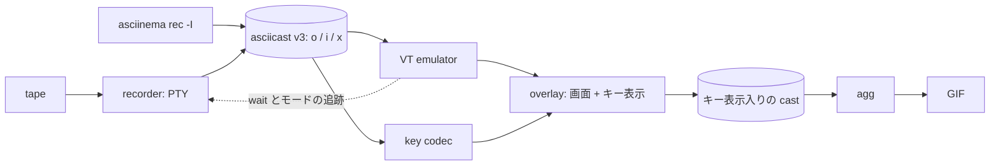
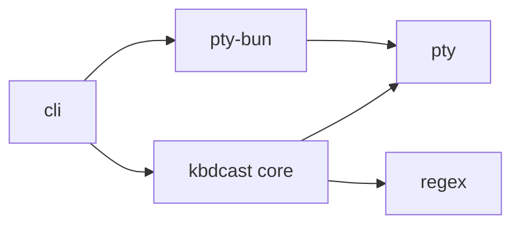
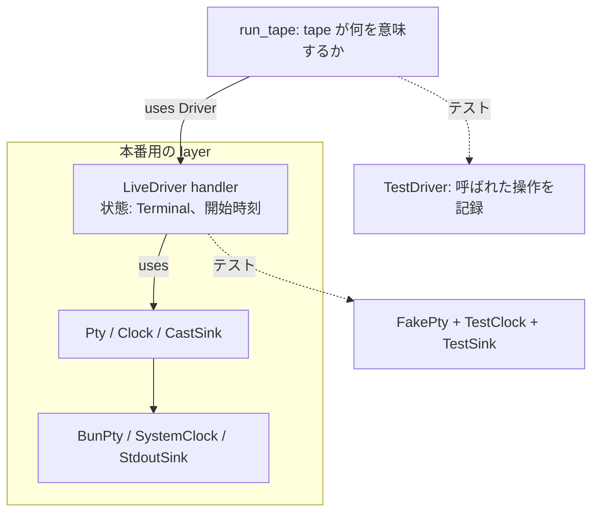
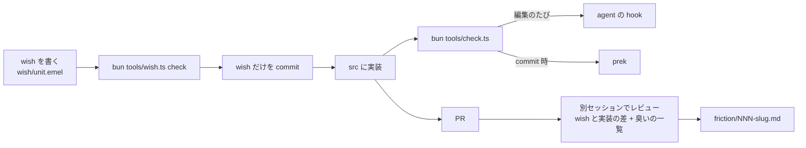

# kbdcast 設計

- 日付: 2026-11-23
- 状態: 全体設計。サブプロジェクトごとの spec は、着手するときに別のファイルとして書く

## 1. 目的

kbdcast は、TUI などの端末アプリのデモ GIF を、操作を書いた tape から決定的に作るツールである。GIF には押したキーを表示する。

このプロジェクトには目的が 3 つある。

1. 製品: mxt の README に載せるようなデモ GIF を、キー表示付きで、同じ tape から何度でも作れるようにする。急ぎではない。
2. 学び: 関数型ドメインモデリング、型システム、アーキテクチャ、effect system を、実際のコードで身につける。
3. 貢献: Emela で書き、詰まった所を記録し、issue、proposal、Pome として Emela と ecosystem に返す。

## 2. 既存ツールとの関係

| ツール | できること | kbdcast との違い |
|---|---|---|
| asciinema-player 3.16 以降 | `keystrokeOverlay` で `i` イベントのキーを表示する（Web） | GIF にはならない |
| agg | asciicast を GIF にする（GPL-3.0 以降）。Noto CJK JP を同梱 | キー表示がない。kbdcast は最終段にそのまま使う |
| VHS | tape から GIF を作る。`Wait` は画面に対する regex | キー表示がない（README に記述がない）。tape の文法が vim 表記ではない |
| `asciinema rec --capture-input` | 手で操作して `o` と `i` を録る | 決定的ではない。kbdcast の入力にもなる |

kbdcast だけが持つ価値は「tape で決めた通りに録る」と「キー表示を GIF に焼き込む」の 2 点である。

## 3. 範囲

対象:

- 入力: kbdcast の tape と、`asciinema rec --capture-input` の cast
- 出力: キー表示を焼き込んだ asciicast v3。GIF にするのは agg。途中の cast（`i` イベント入り）も成果物として扱う
- ターゲット: Emela の JS ターゲットを Bun（`EMELA_JS_HOST=bun`）で動かす。native は後で、わざと詰まりに行く回として別に扱う

非目標（要るまで足さない）:

- MP4 や WebM の出力、自前の GIF エンコーダとラスタライザ
- Windows
- 録画中の端末の大きさの変更、環境変数の追加、VHS の Hide/Show にあたるもの
- GIF のバイト単位の一致。決定性は、画面の中身が同じになるところまでとする

## 4. 全体の流れ



CLI:

```sh
kbdcast rec demo.tape > demo.cast           # i イベント入り。asciinema-player でもそのまま見られる
kbdcast overlay demo.cast > demo.keys.cast  # キー表示を焼き込む
agg demo.keys.cast demo.gif
```

出力はすべてテキストなので、標準出力に書く。

## 5. 分割と順序

| 順 | サブプロジェクト | 中身 | 単体で得られるもの | 主に出る見込みの friction |
|---|---|---|---|---|
| 0 | 仕組み | AGENTS.md、`friction/`、`wish/`、`tools/check.ts`、hook、prek、レビュー用の skill、版の固定 | 以降の記録の土台 | 公式の Linux バイナリの glibc（friction 001） |
| R | regex | 汎用の正規表現の Pome | ecosystem への貢献 | 文字の扱い、Array と Map の性能 |
| 2 | key codec | Key、表記、encode、decode | tape のキー表記と overlay の表記 | enum の設計 |
| 3 | VT | parser、screen、幅の表、端末への返事 | `wait` と overlay の前提 | `Array.set` のコピー、幅の表、UTF-8 のストリーム |
| 1 | recorder | tape、Driver、pty、pty-bun、`kbdcast rec` | tape から cast を作る | host の境界、callback、Bytes |
| 4 | overlay | 合成、`kbdcast overlay` | agg を通して GIF | 長い cast での性能 |

順序の理由:

- tape のキー表記は 2 にある。キーの encode が依存するモードと、`wait` が見る画面は 3 にある。純粋な部品から作れば、どの段も最初から最終形になり、途中で意味を変える非互換を作らずに済む。
- R は外に依存しない純粋な library で、一番早く公開できる。kbdcast 本体のドメインに入る前に、よく知られた問題の上で friction の記録の流れを一度回す練習にもなる。
- 2 と 3 の開発中に使う実データは、`asciinema rec --capture-input` で mxt などを録って作る。

各サブプロジェクトは、着手するときに spec、plan、実装の順で回す。

## 6. tape 言語

### 例

```text
" vim のデモ
set size 80x24
set typing 60ms
run vim notes.md
wait /notes\.md
> ihello<Esc>
sleep 1s
> :wq<CR>
```

### 行の種類

| 行 | 意味 | 書ける位置 |
|---|---|---|
| 空行 | 無視する | どこでも |
| `" ...` | コメント（行頭が `"`） | どこでも |
| `set size <cols>x<rows>` | 端末の大きさ。既定は 80x24 | `run` より前 |
| `set typing <dur>` | 1 キーを送るたびに待つ時間。既定は 50ms | どこでも |
| `set timeout <dur>` | `wait` が待つ上限。既定は 10s | どこでも |
| `run <command...>` | 起動するコマンド | ちょうど 1 回 |
| `wait /<pattern>` | パターンが画面全体に現れるまで待つ | `run` より後 |
| `> <keys>` | vim 表記のキー列を送る | `run` より後 |
| `sleep <dur>` | 待つ | `run` より後 |

- `<dur>` は `<整数>ms` か `<整数>s` で、単位は省略できない。vim の `:sleep 500m` の `m` は分と紛らわしいのでエラーにし、`ms` を勧める。
- コマンドの行では、行頭の空白を無視する。

### キー表記（`>` の行）

- `>` の後の空白 1 つを区切りとし、その後ろを行末まで読む。2 つ目以降の空白は、空白のキーとして送る。キーが 1 つもない行はエラーにする。
- vim の `:help key-notation` に合わせる。名前は大文字と小文字を区別しない。
  - 特殊キー: `<CR>`（別名 `<Enter>`、`<Return>`）、`<Esc>`、`<Tab>`、`<BS>`、`<Del>`、`<Space>`、`<Up>`、`<Down>`、`<Left>`、`<Right>`、`<Home>`、`<End>`、`<PageUp>`、`<PageDown>`、`<Insert>`、`<F1>` からの F キー、`<lt>`
  - 修飾: `C-`、`M-`（別名 `A-`）、`S-`、`D-`（super）。重ねて書ける（`<C-S-x>`）
- 行末で Enter は送らない。mapping の右辺と同じく `<CR>` を明示する。
- vim と違う点は 1 つ: `<`、英数字と `-` の並び、`>` という形なのに名前を知らないもの（`<Ecs>`）はエラーにする。この形にならない `<`（`a < b`）は文字として送る。
- キー名の一覧と、修飾の組み合わせの規則（F キーの上限、`<S-a>` と `A` の関係など）は 2 の spec で決める。

### 時間の扱い

- 時間は書いた所だけで流れる。行と行の間には何も足さない。
- `>` の行: キーを 1 つずつ、その時点の端末のモードで bytes にし、1 キーを 1 つの `i` イベントとして送る。送るたびに `typing` の分だけ待つ。待っている間も出力は読み続ける。
- `sleep`: 指定した時間、出力を読み続ける。
- `wait`: パターンが画面に現れた時点で次に進む。`timeout` を過ぎたら失敗し、行番号、パターン、その時点の画面を出す。
- パターンは `/` の後ろから行末まで。閉じの `/` は書かず、行末の空白もパターンに含む。構文は regex の Pome のもので、R の spec で決める。

### 開始と終了

- `run` の引数はシェル風に分ける（`'...'`、`"..."`、`\`）が、シェルは通さない。環境変数は kbdcast のものを引き継ぎ、`TERM=xterm-256color` を設定する。作業ディレクトリは tape のあるディレクトリにする。
- 最後の行が終わったら録画を終える。プロセスが残っていれば終了させる。
- プロセスが終了したとき、実行していた行が最後の行でなければエラーにし、その行の番号を出す。最後の行なら録画を終える（`> :wq<CR>`）。ただし最後の行が `wait` で、パターンがまだ現れていなければエラーにする。

## 7. Pome の構成

1 つの repo（`github.com/kisepichu/kbdcast`）に directory Pome を並べる。分け方は spec の `[module.pome]` が勧める「effect だけの Pome、ターゲット別の handler Pome、ターゲット別の entry Pome」に従う。

```text
kbdcast/
├── Pome.toml        github.com/kisepichu/kbdcast          core。@external を持たない
├── src/
│   ├── key.emel, key/{notation,encode,decode}.emel        (2)
│   ├── utf8.emel                                          UTF-8 のストリーム用デコーダ
│   ├── vt/{parser,screen,width}.emel                      (3)
│   ├── cast.emel                                          asciicast v3 の読み書き (Std.Json)
│   ├── tape.emel, recorder.emel                           (1)
│   └── overlay.emel                                       (4)
├── test/
├── regex/           github.com/kisepichu/kbdcast/regex     (R) 汎用の正規表現
├── pty/             github.com/kisepichu/kbdcast/pty       effect Pty の宣言だけ。全ターゲットで使える
├── pty-bun/         github.com/kisepichu/kbdcast/pty-bun   handler BunPty。targets = ["js"]
├── cli/             github.com/kisepichu/kbdcast/cli       main。[external] allow = [pty-bun]
├── wish/            理想のコード（src の外）
├── friction/        回り道の記録
├── tools/           check、lint、wish check
└── AGENTS.md
```



決めごと:

- `@external` は pty-bun（後で pty-native）にだけ置く。dependency の Pome については、`[external] allow` に無ければコンパイラが E0233 にする。core、regex、cli の中の `@external` は lint で止める。
- lint の対象は core、regex、cli の `src/`。`pty*/`（host を触る library）と `test/`（Test 用の handler や、テストで正解役として呼ぶ `@external` を置く）は対象外とする。
- 対象の中では、基盤レベルのキーワード（`effect`、`handler`、`layer`、`suspend`、`trait`、`impl`、`@external`、明示した `fails` と `uses`）を、`tools/lint/foundation.allow` に理由と一緒に登録したモジュールでだけ使える。それ以外の場所に出てきたら `FRICTION(NNN)` の印が要る。
- 兄弟の Pome は `[replace]` で参照する。Pome の置き場所（source path）は最初の tag を打つときに決める。tag を打つ前なら、移しても名前の書き換えだけで済む。regex と pty は、独立した repo に移す可能性がある。
- PTY の寿命は handler の init と release に乗せる（`with BunPty(argv, size) { ... }`）。init でプロセスを起動し、release で止める。

## 8. ドメインモデル

### 方針

| 方針 | kbdcast での使い方 |
|---|---|
| Parse, don't validate | tape のパーサは、正しくない形を表現できない `Tape` を返す（`run` は 1 回だけ、`size` は `run` の前、steps は `run` の後） |
| 不正な状態を表現できなくする | Bool を並べずに enum を使う（`CursorKeys = Normal \| Application`）。値に範囲があるもの（`F(n)`）は、opaque な型と検査付きの構築関数で作る |
| エラーは型で表す | 想定内の失敗は `fails` で返し、tape の行番号を持たせる。バグは defect にする |
| 純粋な core | VT、key codec、overlay は純粋な関数の fold として書き、effect を付けない |
| effect は 2 つの層の port | host の port（`Pty`、`Clock`、`CastSink`）と、ドメインの port（`Driver`）。handler が adapter、layer が「本番用」「テスト用」の組み合わせ |

opaque な型と構築関数の Emela での書き方は、R の段階で spec を見て確かめる。

### 主要な型

| 型 | 中身 | 置き場所 |
|---|---|---|
| `Key(code, mods)` | `KeyCode` は `Char \| Enter \| Esc \| Tab \| ... \| F(n)` | 2 |
| `InputModes` | `CursorKeys`、bracketed paste、kitty flags。VT が持ち、encoder が読む | 2 と 3 |
| `encode(Key, InputModes) -> Bytes` | 今のモードで表せないキーは `fails Unencodable` | 2 |
| `decode(Bytes) -> List[Decoded]` | `Decoded` は `Key \| Paste \| Unknown(Bytes)`。失敗しない | 2 |
| `Terminal.feed(t, Bytes) -> (Terminal, List[Reply])` | UTF-8 のデコード、parser、screen の fold | 3 |
| `Event` | `Output \| Input \| Resize \| Marker \| Exit` | cast |
| `Tape(settings, command, steps)` | `Step` は `Keys \| Sleep \| Wait \| SetTyping \| SetTimeout` で、それぞれ行番号を持つ | 1 |

### キーの出どころ

overlay に出すキーは、常に `i` イベントの bytes をデコードして作る。tape 由来と `asciinema rec --capture-input` 由来を同じ経路で扱うためである。

- recorder は 1 キーを 1 つの `i` イベントにするので、単独の ESC か Alt の接頭かはイベントの切れ目で区別できる。
- legacy の表現で区別できないもの（Tab と `<C-i>`、Enter と `<C-m>`、BS が 0x7f か 0x08 か）は、一般的な名前で表示する。

### 端末への返事

crossterm などは起動時に、カーソル位置（`CSI 6n`）、DA1、kitty keyboard protocol の対応（`CSI ? u`）を端末に問い合わせ、返事を待って止まることがある。そのため `feed` は返事（`Reply`）も返し、recorder はそれを PTY に書き戻す。overlay は録画済みの cast を処理するだけなので、返事は捨てる。

kitty の対応を「ある」と答えるとアプリが kitty flags を有効にし、それに合わせて encoder が CSI u を出すようになる。既定でどう答えるかは 3 の spec で決める。

### cast

- 形式は asciicast v3。時刻は前のイベントからの間隔で書く。間隔の丸めは、v3 の推奨どおり誤差を次に持ち越して、累積のずれを防ぐ。
- 書くイベントは `o`、`i`、`x`。読むイベントは `o`、`i`、`r`、`m`、`x`。知らないコードは無視する（v3 の規則）。
- 内部では録画開始からの経過時間で持ち、間隔との変換は codec だけが行う。

## 9. recorder

### effect の 2 層



- `run_tape` は「tape が何を意味するか」だけを書いた普段のレベルのコードで、`use Driver` しか使わない。
- 端末をどう動かすかは `LiveDriver` の中に閉じ込める。

最初の wish（spec を確かめる前に推測で書いたもの）:

```emela
effect Driver {
  suspend fn press(key: Key) -> () fails Unencodable | ProcessExited
  suspend fn idle(d: Duration) -> () fails ProcessExited
  suspend fn wait_for(p: Regex, timeout: Duration) -> () fails WaitTimeout | ProcessExited
}
```

`effect Driver` と `handler LiveDriver` は設計として意図した基盤レベルのコードなので、`foundation.allow` に登録する。

### 並行処理

- fiber 1 本で回す。時間が流れる操作（`idle`、`wait_for`、キーを送った後の待ち）は、すべて「期限まで PTY の出力を読んで `feed` し続ける」処理にする。読み込みは `Fiber.timeout` で打ち切る。
- fiber 間で状態を共有しないので、`TestClock` の下で決定的に動く。

### Pty effect の要件

- `read` は届いたデータを Bytes で返す。読み込みを打ち切られても、届いていたデータを失わない。
- `write(Bytes)` で入力を送る。
- プロセスの終了と終了コードを知らせる。
- 操作の正確な形は 1 の spec で決める。

### エラー

- `run_tape` は、Driver から受けたエラーに `escape` で tape の行番号を足して外に出す。
- `WaitTimeout` には、その時点の画面のテキストを持たせる。
- tape の構文エラーは、行、列、理由を持つ。

## 10. overlay

- 入力は `i` イベント入りの cast、出力はキー表示を焼き込んだ cast。
- 自前の VT で画面を作ってキー表示を重ね、合成した画面を描き直す出力として書き出す。それを agg が描く。
- キーは `i` イベントのデコードから作り、表示には tape と同じ vim 表記の printer を使う。
- 配置（行を足すか、画面に重ねるか）、表示する時間、まとめ方（連続する文字を 1 つにする、`<Esc> × 3` のように回数で表す）、描き直す範囲は 4 の spec で決める。

## 11. テストの戦略

テストは `@test` に、brix の assert と pbt を使う。

| 対象 | 主な手法 | 中身 |
|---|---|---|
| regex | 性質テスト + 差分テスト | 対応する範囲のパターンと文字列をランダムに作り、一致するかどうかを JS の RegExp と比べる。RegExp は `test/` の中で `@external` を通して正解役（oracle）として呼ぶだけで、製品のコードには入らない |
| key codec | 性質テスト + golden | `parse(print(k)) == k`。モード m で表せる k について、`decode(encode(k, m))` が k の同値類に入る。golden の表は、WezTerm の上で `asciinema rec --capture-input` を使い、既知のキーを実際に打って作る |
| VT | 性質テスト + 差分テスト + golden | 入力をどこで分割しても結果が変わらない（`feed(feed(t, a), b) == feed(t, a ++ b)`）。UTF-8 やエスケープシーケンスの途中で切れる場合もまとめて検査できる。カーソルが画面の外に出ないことも見る。差分テストの参照は avt（agg が中で使う emulator）で、小さな Rust の harness でスナップショットを出す |
| tape のパーサ | golden | パース結果と、エラーの行、列、文言 |
| recorder | fake | `TestDriver` で、tape から操作の並び（キーを送る間隔を含む）を見る。`FakePty` と `TestClock` で、問い合わせへの返事、遅れて届く出力、途中での終了を決定的に再現する |
| pty-bun | 結合テスト | 本物の PTY で `cat` や小さなスクリプトを動かす。時間は揺れるので、中身だけを確かめる |
| overlay | golden | 合成した画面（文字と属性） |
| E2E | smoke | tape、cast、overlay、agg を通す。比べるのは最終画面のテキストで、GIF のバイトは比べない |

## 12. 開発手法

### 基本方針

- Emela で直接書く。Koka などで先に書いて写すことはしない。
- 回り道はすべて記録する。agent は回り道を普通のコードだと思い込むので、検知を自己申告に頼らず、仕組みで拾う。
- Koka は、苦しい箇所に概念の名前（FBIP、reuse analysis など）を付けるためだけに小さく書く。得た名前は proposal の Prior art に使う。

### 流れ



### AGENTS.md に書く規則

1. wish-first: 単位ごとに、spec を調べる前に推測の文法で理想のコードを `wish/` に書き、`bun tools/wish.ts check` の診断を貼ってから、wish だけを commit する。
2. 黙って回避しない: 回避したら、コードに `# FRICTION(NNN)` の印を付け、`friction/NNN-slug.md` を作る。
3. 基盤レベルのキーワードは `foundation.allow` に登録したモジュールでだけ使う。
4. 1 件 1 決定: 1 つのメモには 1 つの論点だけを書く（proposal の「1 draft に 1 決定」に揃える）。
5. 版の固定: Emela の版を上げたら、open のメモをすべて見直す。消えた friction は進歩の記録として resolved にする。

### friction のメモ

```md
# NNN <slug>

- 状態: open | filed | resolved | dropped
- Emela: v0.28.2
- 意図:
- こう書きたかった: wish/<unit>.emel の該当部分
- 診断: (E0443 など)
- 回避策:
- コスト: 行数 / 性能 / 普段のコードに基盤レベルが漏れたか
- spec: [ext.boundary] など
- 既存: open question / issue / proposal
- 行き先: 分類とリンク
```

分類と行き先:

| 分類 | 行き先 |
|---|---|
| 自分の誤解だった | ドキュメントや診断メッセージの改善（`spec/diagnostics.md`） |
| spec と実装がずれている、またはバグ | issue |
| 既に知られている制限（`open-questions.md`、Known limitations） | 実際の使い道を添えて issue にするか、既存のものに足す |
| 前提の範囲内で spec に足りない | proposal の下書き（`emela-proposal` skill で詰める） |
| 前提（`[intro.premises]`）に反する | 捨てる。コストだけメモに残す |

### 仕組み

| 部品 | 中身 |
|---|---|
| `AGENTS.md` | 上の規則、メモの雛形、分類の表。`CLAUDE.md` からは AGENTS.md を参照するだけにする |
| `wish/` | 理想のコードを src の外に置く。この repo の中で src の外のファイルを `emela check` に渡すと E0208 になるので、`bun tools/wish.ts check` が repo を一時ディレクトリに写し、wish を置く予定の場所に書いてから検査し、診断をファイルの末尾に貼る |
| `tools/check.ts` | 全部の検査の入口: Emela の版の確認、各 Pome の `emela fmt --check` と `emela check`、lint（対象の `src/` にある、allowlist の外の基盤キーワードと `@external`）、`FRICTION` の印に対応するメモがあるか、メモの必須欄 |
| agent の hook | Claude Code は `.claude/settings.json`。編集後（PostToolUse）に `tools/check.ts` を走らせて結果を返し、ターン終了時（Stop）に fail なら続けさせる。omp は `.omp/hooks/post/` の factory で、`tool_result` と `session_stop` を使って同じことをする |
| prek | `.pre-commit-config.yaml` の local hook から `tools/check.ts` を呼ぶ。agent に依存しない最後の砦 |
| レビュー | `.agents/skills/friction-review/` に置き、`.claude/skills` からリンクする（emela の流儀）。PR ごとに別のセッションで動かし、wish と実装の差と、臭いの一覧（回避のためだけの補助関数、String を経由した base64、自前の UTF-8 処理、まわりくどい再帰、Option の握りつぶし）を走査する |
| 版の固定 | mise の `github:emela-lang/emela` で v0.28.2 を固定する |

`tools/` は Bun 上の TypeScript で書く。Bun は JS の host として元々要るので、追加の依存はない。lint が要るのは Emela のコードを書き始める前で、そのときはまだ regex もない。道具づくりは学びの対象ではないが、後で Emela に移すのは friction の多い練習として良い題材になる。

## 13. Emela への貢献候補

| 候補 | 現状 | 行き先 | kbdcast で当たる所 |
|---|---|---|---|
| 正規表現 | std に無い。issue、PR、proposal を探したが対応するものは無い。std の方針（`15-stdlib.md`）は、形の決まっていない純粋な部品をまず std の外に出すこと | regex の Pome として公開する。必要なら使い道付きの issue を立てる。動機に使える材料: `Std.Shape` の `pattern` 注記は正規表現を持つのに Emela の中で検査できない、`proposals/array.md` が正規表現エンジンの遷移表を例に挙げている | R |
| PTY | std にも ecosystem にも無い | pty と pty-bun の Pome として公開する | 1 |
| native の C FFI で Bytes、Array、callback を渡せない | open question #38（`[ext.boundary]`）。issue は無い | PTY の使い道を添えて issue にする | pty-native |
| `Array.set` が in place になるかを確かめられない | WASM と C では「最後の参照なら in place」と約束されている（`[api.std.array]`）。in place になるかをコンパイラが教える仕組みは無く、JS は常にコピーする | VT の画面バッファで測った数字を添えて、前提の範囲内の proposal の候補にする | 3 |
| native に `String.chars` が無い | Known limitations に記載（grapheme の表が無い） | 使い道を添える | 3 を native で動かすとき |
| ストリーム用の UTF-8 デコーダが無い | `Bytes.decode_utf8` は入力全体が正しくないと `None` を返す | 実装してから、std か Pome かを判断する | 3 |
| 複数の Pome をまとめる workspace | spec が「後の版で考える」としている（Bushel）。`[replace]` だけでもネットワーク無しで動くことは確かめた | 兄弟の Pome を `[replace]` で扱った実例を添える | 0 以降 |
| 公式の Linux バイナリが glibc 2.39 の weak シンボル（`pidfd_spawnp`、`pidfd_getpid`）を要求する | README は「Linux (x86_64)」とだけ書いている。release は `ubuntu-latest` で build している。issue は無い | friction 001。issue にする | 0 |
| FileSystem でバイナリを扱えない | Known limitations に記載 | kbdcast では当たらない（GIF は agg が書き、kbdcast が書くのは cast だけ） | なし |
| #687 Implement: A built-in trait for capability types | 担当者が 0 人（2026-11-23 時点） | 実装で貢献する | kbdcast とは別 |

## 14. 確かめていないリスク

- 公開していない兄弟の Pome を `[replace]` で参照したときの lock の振る舞い。0 で確かめ、ネットワーク無しで動くことを確認した（replace した依存は lock に載らない）。
- `Bun.Terminal` の API の細部（データの渡し方、resize、終了コード）。pty-bun の handler の中で、pull 型の `read` に合わせる。1 で確かめる。
- omp が Claude Code の hook を読むか。0 で確かめ、読まないことを確認した。omp には `.omp/hooks/post/` の factory を別に置く。
- mise の `github:` backend で emela のリリースが取れるか。0 で確かめ、取れることを確認した。ただし公式の Linux バイナリは glibc 2.39 の weak シンボルを要求し、Ubuntu 22.04 では呼ぶたびに警告が出る（friction 001）。
- Emela 0.29 で capture checking が既定になる予定（#666）。版を固定し、上げるときにメモを見直す。
- JS ターゲットでは `Array.set` が常にコピーするので、VT の画面の更新が遅い可能性がある。3 で測る。
- overlay が画面を描き直す出力は cast を大きくする。差分だけを出すかどうかは 4 で決める。
- avt の harness のための Rust のビルド。3 で用意する。

## 15. 決定の記録

| 論点 | 採用 | 採らなかった案と理由 |
|---|---|---|
| 描画 | 合成までを自前で書き、ピクセルは agg に任せる | 全部自前（フォントと GIF エンコーダで範囲が膨らむ）、SVG のフレーム（外部への依存が増え、Emela 側で得られる発見は同じ） |
| tape の文法 | 独自の文法。コマンドは行単位、キーの行は `>` | VHS 互換のサブセット（vim 表記にできない）、疑似キーを混ぜる（新しく覚えることが残り、行が長くなる）、コマンドの行に印を付ける（行頭の印の escape という例外が残る） |
| 時間 | 書いた所だけで流れる | 行の後に既定の間を入れる（暗黙の規則が増える。後から既定 0 で足せる）、行ごとに速さを上書きする（記法が増える） |
| 正規表現 | 汎用の構文の Pome を作る | 文字列の一致だけ（貢献につながらない）、vim の方言（他の場所で使い回せない） |
| キーの出どころ | 常に `i` イベントをデコードする | tape のラベルを別に持つ（経路が 2 つになる） |
| 決定性 | 画面の中身が同じになるところまで | GIF のバイト一致（PTY の時間の揺れがあり、CI での比較も中身で足りる） |
| ターゲット | JS（Bun）を先にする | native を先にする（詰まって止まりやすい） |
| recorder の並行処理 | fiber 1 本で出力を読み続ける | 読み込み用の fiber と queue（状態を共有することになり、テストが決定的でなくなる） |
| 順序 | 0、R、2、3、1、4 | recorder を先にする（`wait` を一度仮の意味で作り、後で意味を変えることになる） |
| tools の言語 | Bun 上の TypeScript | Emela（Emela のコードより前に要り、そのときはまだ regex もない） |
